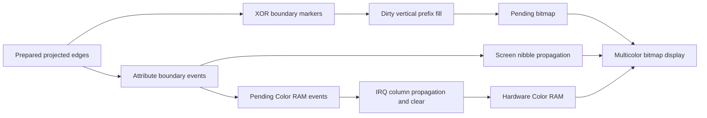

# The Lab ball: independent colors reach two committed viewports

Research date: 9 November 2026. The new scalar model predicts the ball's
bitmap, screen attributes and hardware Color RAM from original prepared edges
and a genuine pre-edge machine state. Its result matches **all 104,448 palette
indices in each of two complete 384×272 committed normal PAL viewports**.
Ending native attribute bytes and retained pixels are comparison oracles only.

This extends [the scene identification](the-lab-ball.md) through a full color
output check. It remains one bounded original-file-22 pose, not a proof of
every pose, arbitrary geometry, physical RGB output or animation FPS.

## The actual pipeline

The released C64 code and the independent reference follow these stages:



The two-bit bitmap selects background, screen high nibble, screen low nibble,
or Color RAM. Different character cells select different triples of colors.
Thus the number of visible polygons is unrelated to the eight hardware
sprite channels. This new window has **D015=$00**, so enabled sprites do not
contribute to its compared output.

Attribute filling is not another bitwise XOR. Screen events selectively
replace one or both nibbles of a running column value. Color RAM events replace
the running color when nonzero; zero means hold. Both propagators clear
consumed events. Those sentinel rules constrain the usable encoding; this is
not an unrestricted palette-transition or depth-buffer algorithm.

## Genuine inputs and exact source generations

The [fresh native custody](the-lab-ball-native.md) starts the original side-two
D64 directly. Its decorative one-block DOS entry actually chains through ten
sectors. All 2,508 loaded bootstrap bytes match, followed by the original
7,162-byte file-zero output and all 14,156 file-22 bytes at the script call.
The host startup failure and a later rejected long monitor condition remain
retained; neither contributes a source-phase input to this model.

The accepted pre-edge stop is original PC `$2209`, clock 237,344,381, with
stream pointer `$BFE8`: prepared pose 52, containing 34 commands. Its actual
translation bytes are `$FD/$EC`, or **−3/−20**. Its palette is a partial fade,
not the older identity-palette “TEN!” capture. Both 576-byte attribute event
planes and the 4,608-byte marker plane are observed empty before drawing.
The scale tables, palette, previous background and device colors are explicit
entry inputs. No padded zeros from a decoded RAM image stand in for live state.

The original stream contains projected endpoints, slopes, transition codes
and attribute operations. The C64 still samples, rasterizes, fills and colors
them. These results do not establish live rotation/projection or the original
exporter's mesh, visibility or depth-order algorithm.

## What the independent reference reproduces

The [pixel producer](../../research/the-lab/ball_pixels.py) preserves the
original fractional/high-byte carry chain. It computes 288 horizontal edge
samples and matches all **4,608 marker bytes**. Dirty bounds come from mapped
start/end X and both starting and one-past-final kernel Y, rather than the
bounding box of nonzero markers alone.

The [source-derived fill descriptors](the-lab-ball-display-source.md) give
byte columns `[2,20)`, global top character row 0, and fixed per-column bottom
limits for this input. The normal filler therefore predicts **3,216 logical
bitmap stores**. Every resulting byte in the complete 8,000-byte pending bitmap
matches the native endpoint. Bytes outside those spans retain the genuine
prior background. This is not a blanket replacement of the larger 3,872-byte
attribute crop. The current watch ranges do not capture every bitmap store;
the complete byte-value comparison and the source-derived address/count
prediction are distinct evidence.

The [attribute model](the-lab-ball-attributes.md) independently predicts:

- The full 1,000-byte pending screen: 484 computed cells and 516 preserved cells.
- All 576 pending Color RAM event slots, including 16 written cells.
- All 576 screen-event bytes after consumption and the persistent patches
  across the 1,422-byte supplied attribute-code region.
- All 93 watched event-store PCs, addresses and values, compared after prediction.

The 1,422 attribute-code bytes are supplied code with runtime patches. The
separate **2,304-byte bitmap filler** is generated by the original initializer.

The [publication model](the-lab-ball-publication.md) takes that predicted
Color RAM event plane plus the true pre-body device state. It predicts all
1,024 device nibbles and the cleared 576-byte shadow. All **484 ordered Color
RAM stores** match native source PCs, addresses and accumulator values. Only
26 device cells change, but the shaped propagation routine still writes 484.
RAM beneath `$D800` while CPU port is `$34` remains distinct from hardware
Color RAM accessed with I/O mapped under `$35`.

## Publication and committed pixels

At `$2265` the backbuffer is complete but not requested. `INC $44` queues it.
The IRQ toggles the selector and writes CIA2 bank selection before D018.
Original `$21A9` is after those selects but **before** the Color RAM copy;
`$21AC` is after the copy and before decrementing the request.

For the first compared display field:

| Boundary | PAL machine clock |
| --- | ---: |
| New bank and D018 selected | 237,441,570 |
| Start of the field whose viewport is compared | 237,444,480 |
| Color RAM copy returned | 237,447,041 |
| First graphics row, raster 51 | 237,447,693 |
| First completed-field stop, raster 0/cycle 1 | 237,464,137 |
| Second completed-field stop, raster 0/cycle 4 | 237,483,796 |

Colors are ready **652 cycles before the first graphics row**. The source
copy costs 5,471 cycles: the typed cost formula includes sixteen nonzero events
and five taken-branch page crossings. Every one of its 484 store-completion
offsets agrees with the observed clocks. That claim is conditional on the
checked model, disabled sprite DMA, IRQ state and absence of PAL badlines in
this specific interval; it is not a timing model for the entire renderer.

The compared viewport covers raster rows 16–287. The 320×200 graphics body
starts at physical `(32,51)` in the unpadded 384×312 allocation. Each multicolor
selector expands to two physical pixels. The join uses independently predicted
bitmap, screen and Color RAM bytes, plus declared initial background/border.
Both complete 104,448-byte viewport comparisons are exact. All relevant mode
stores are accounted for; there are no later D018/CIA2 bank-control stores in
the watched interval. Row 0 itself is outside the compared normal viewport;
this does not claim all 312 allocated rows are newly committed.

The next render has already begun at the field endpoints. Its global palette
and pending event arrays may differ. They are not used to recolor the displayed
pose: publication froze the earlier per-cell attributes. This generation
distinction prevents a false match using the next pose's palette.

## Bounded cost and reproduction

The captured full render body takes **87,209 PAL machine cycles**, about 4.44
PAL fields, including IRQ/VIC work. Pre-edge to event completion is 26,452
cycles; event completion to the filled/attributed backbuffer is 60,721 cycles.
The remaining 36 cycles precede edge processing. Queued request to bank
selection adds 10,011 cycles; the following color-copy interval adds 5,471.
These boundary measurements are not delivered FPS or host wall-clock timing.

The [accepted receipt](../../build/research/lab-polygons-20261109/pixel-analysis/accepted-01/ball-pixels-proof.json)
pins the complete input/prediction/oracle partition and outputs. The
[independent peer replay](../../build/research/lab-polygons-20261109/pixel-analysis/peer-replay-check.json)
matches all nine files, totaling 361,348 bytes. The earlier zero-translation
rejection, successful bitmap probe and explicitly native-attribute-based
decoder diagnostic remain separate from final full-color acceptance.

```sh
rtk proxy python3 -B research/the-lab/ball_pixels.py --output build/research/lab-polygons-20261109/pixel-analysis/<fresh-directory>
```

The broader research goal remains active. Later full-palette/speech variants,
other poses, general clipping/crop safety, source exporter geometry, complete
animation cadence and physical output remain open. Future native capture must
create a short checkpoint, validate the response, and only then continue;
the retained [monitor input contract](../../build/research/lab-polygons-20261109/native-analysis/monitor-line-contract-01/README.md)
explains the rejected long-condition attempt.
